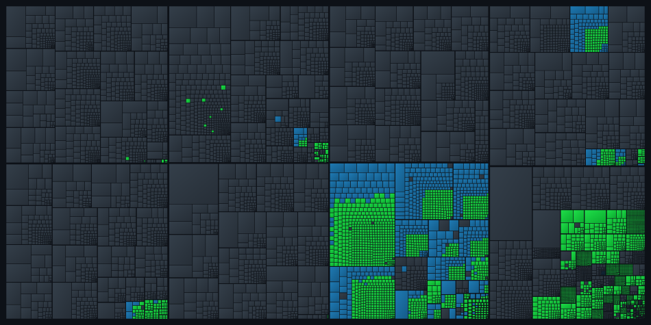

# Psychonauts


-orange)


A work-in-progress decompilation of Psychonauts (2005, PC).

The game is split into two very different parts:

- **The engine** (`Psychonauts.exe`): C++, 32 bit x86. Rendering, physics, audio, loading, the Lua runtime. **Started:** the Lua runtime matches completely. Of the C++ part the glue around the script functions is done and the script functions themselves are in progress.
- **The scripts**: Lua 4.0 with some Double Fine changes. Raz, enemies, bosses, cutscenes, every level script. **Done:** every function decompiles to source that recompiles to the exact same bytes.

This repository does **not** contain any game assets or game code. You need your own copy of the game.

## Progress

| Part | Matching | Notes |
| --- | --- | --- |
| Lua scripts | 106607 / 106607 functions (100 %) | 9955 bytecode chunks from `.lub`, `.lpf`, `.ppf` and `.pkg` files |
| Engine | 3232 / 10930 functions (29.57 %), 9.53 % of the code | Lua 4.0 runtime in `src/lua` complete, script functions in `src/game` in progress |



Every rectangle is one function of the engine, sized by its code. Green ones match, blue ones are known by name but not decompiled yet (mostly the script functions), gray ones haven't been looked at. The eight big blocks split the code by address. Inside them the functions are grouped by object file where that is known. The rest is cut into pieces of similar size, because most object boundaries are not known yet. decomp.dev draws the same kind of map, but it needs the original executable in the CI, so this one is drawn locally. `python3 tools/progressmap.py engine/functions.csv engine/progress.svg` draws it again after a new match run.

"Matching" means the decompiled function, compiled again, gives byte for byte the same code as the original. For the scripts that is Lua bytecode, for the engine x86 machine code. The tools check this for every single function, so the numbers above are not estimates.

The function count runs ahead of the real progress right now: more than 2200 of the matching engine functions are small pieces generated by one macro (see below). The share of the code in bytes is the better number for the engine.

The engine is by far the bigger part of the game, so the project as a whole is still near the start.

## Supported version

Only the current Steam version has been tested. Its executable:

```
Psychonauts.exe  sha1 21e9b89c80347c8360a8ce4b17ce45e7cd1d4a07
```

The GOG release probably has the same scripts, but I haven't checked.

## Dependencies

Linux or WSL with:

- Python 3
- gcc
- for the engine: `pip install pefile capstone`, Visual C++ 2008 (see below) and Wine if you are not on WSL

## Decompiling the scripts

Build the patched Lua compiler:

```sh
sh psyluac/build.sh
```

Then point the decompiler at your game folder:

```sh
python3 tools/psydec.py "/path/to/Psychonauts" decomp psyluac/psyluac
```

After a few minutes you get:

- `decomp/lua/` with all scripts, laid out like the game files (`decomp/lua/WorkResource/PCLevelPackFiles/ASCO/...` for `ASCO.ppf` and so on)
- `decomp/report.txt` with the result for every chunk
- `decomp/manifest.json`, needed for repacking
- `decomp/failed/` with the original bytecode of anything that didn't match (should not exist)

Without the `psyluac/psyluac` argument the output is not checked.

## Diffing

To look at a single function, original and recompiled side by side:

```sh
PSYLUAC=psyluac/psyluac python3 tools/compare.py original.lub decompiled.lua main.0.5
```

`main.0.5` is the path through the nested functions: the sixth function inside the first function inside the main chunk.

## Repacking (experimental)

Edited scripts can go back into the game files:

```sh
python3 tools/psypack.py "/path/to/Psychonauts" decomp psyluac/psyluac mod backup
python3 tools/psyinstall.py install "/path/to/Psychonauts" mod backup
python3 tools/psyinstall.py restore "/path/to/Psychonauts" backup
```

`psypack.py` only recompiles the files you changed. `psyinstall.py` saves the originals to `backup/` before overwriting anything.

Tested so far: text changes in the localization tables show up in game, and a rebuilt `common.ppf` with a shorter script pack loads fine. A change to Raz's gravity in `Dart.lua` showed no effect in the main menu. There are three copies of `Dart` in the game files and it's not clear yet which one is used when.

The `.lua` files are Latin-1 like the originals, so save them as "ANSI" or "Western (Windows 1252)" if you edit on Windows.

## Building the engine

The engine has to be compiled with the same compiler Double Fine used, Visual C++ 2008 without any service pack (version 15.00.21022.08). It was part of the free Visual Studio 2008 Express Edition. The offline ISO with all Express editions has this checksum:

```
sha1 76c6d28274a67741da720744026ea991a70867d1
```

The installer doesn't like Windows 11, but the compiler doesn't need to be installed. It can be unpacked from the ISO instead:

```sh
sudo apt install p7zip-full msitools
7z x VS2008Express.iso VCExpress/Ixpvc.exe
7z x -oixp VCExpress/Ixpvc.exe
cd ixp && msiextract -C ../vc vs_setup.msi && cd ..
mv "vc/Program Files/Microsoft Visual Studio 9.0/VC:Vc7" VC
cp "vc/Program Files/Microsoft Visual Studio 9.0/Common7/IDE/"{mspdb80.dll,mspdbcore.dll,mspdbsrv.exe,msobj80.dll} VC/bin/
mv VC/include/CodeAnalysis VC/include/codeanalysis
```

`VC:Vc7` is really the folder name, msiextract keeps the internal name from the installer. The last line is needed because `sal.h` includes that folder in lowercase and Linux folders are case sensitive. `VC/bin/cl.exe` should now print `Version 15.00.21022.08 for 80x86`.

Then build and compare:

```sh
sh tools/build.sh /path/to/VC
python3 tools/objmatch.py /path/to/Psychonauts.exe engine/functions.csv build/*/*.obj
```

`build.sh` compiles everything in `src/` (C and C++) into `build/`. On WSL it runs `cl.exe` directly, anywhere else through Wine. `objmatch.py` looks for every compiled function in the executable and prints how many match, as functions and as bytes of code. With `--write` it also puts the names into `engine/functions.csv`, `-v` lists every function.

## About the script format

Stock Lua tools can't read Psychonauts bytecode. What's different from Lua 4.0:

- 16 bit instructions instead of 32 bit (opcode 6 bits, B 5, A 5, U 10)
- `float` numbers instead of `double`, header test number `3.14159`
- Three extra opcodes for arguments that don't fit into 5 bits: `EXTARG` (49) carries a big A for the next instruction, `CALLX` (51) and `CLOSUREX` (52) use it. Closures switch to it at index 30, calls at base 32
- `MULT_RET` is 31, lists flush every 31 items, records every 15
- String constants are never duplicated and number constants are searched in full, both differ from stock 4.0
- Level scripts have no debug info, only the localization tables keep local names and line numbers

The decompiler basically runs the Lua 4.0 parser backwards. Some things that took a while: jump threading (jumps onto a `JMP` get redirected to its target), `POP`s merged into a preceding `SETTABLE`, `if nil then` compiling to a bare `JMP`, and `and`/`or` having the same priority in 4.0.

Since the level scripts have no debug info, the original names of parameters and locals are gone for good, and so are the comments. Everything else (globals, table fields, function names, strings, control flow) is original. The decompiler picks names that follow Double Fine's own conventions where it can tell: `self` for methods, `Ob` for the object in class constructors, `k`/`v` and `i` for loops. Everything else gets `a1`, `a2`... for parameters and `l1`, `l2`... for locals, counted per function. Every file is recompiled with these names and falls back to plain generated names if anything would change, so the output always matches.

The blank lines between functions are on purpose. Each function's starting line is stored in the bytecode, so the functions have to stay on their original lines.

## About the engine

What we know so far, from `tools/peinfo.py`:

- The Steam executable was rebuilt in January 2016 and linked with Visual Studio 2008 (linker 9.00).
- The game code itself is 218 C++ and 45 C object files, all compiled with MSVC 2008 RTM (build 15.00.21022). That compiler shipped with the free Visual C++ 2008 Express, so a matching decompilation is possible in principle.
- Besides the usual sections there are two custom ones, `.dflua` and `.dfluatx`, probably Double Fine's Lua bindings.
- No PDB is shipped, only its build path `c:\dfp-p5ya\Psychonauts\Resource\Psychonauts.pdb` is left in the executable.

`tools/funclist.py` finds the functions by disassembling from the entry point, following calls, jumps and switch tables, and then looking at pointers in the data sections and the gaps in between. MSVC aligned every function in this build to 16 bytes, which makes it easy to tell real starts from data that just looks like an address. It ends up with 10930 functions covering 95.5 % of the code. Most of the rest is exception handler stubs the compiler puts at the end of `.text`, they get matched together with their parent function and are not counted on their own.

```sh
pip install capstone pefile
python3 tools/funclist.py /path/to/Psychonauts.exe engine/functions.csv
```

The game code was compiled with `/Od /Oy /Ob1 /Oi /MD /GS-`, so without optimizations. `/Oy` only shows in the few functions with 16 byte aligned locals, they keep `ebp` for the arguments and address the locals through `esp`. That is a lucky break: unoptimized code follows the source very closely, which makes a matching decompilation a lot easier than usual. Functions are padded to 16 bytes with `int3`, exactly like the compiler does it inside an object file.

### The Lua runtime

The first part that was matched is the Lua 4.0 runtime that is linked into the executable, because its source is public. All 510 functions match now. `src/lua` started as the unmodified Lua 4.0 release (the first commit that touches it), everything after that are changes needed to match the executable. Comparing against 4.0.1 gives fewer matches, so Double Fine used 4.0.

Changes found so far:

- Instructions are 16 bit (`SIZE_INSTRUCTION 16`, `SIZE_B 5`), same as in the script files
- Numbers are `float`, also in the C API (`lua_tonumber`, `lua_pushnumber`, `luaL_check_number`)
- New `lua_pushint` and `lua_pushuint`, the libraries use them wherever they push an integer
- `luaM_realloc` takes the old size of the block as a fourth argument, `-1` when it isn't known
- `lua_State` has two more fields after `Mbuffsize`, not clear yet what they are
- No stack size clamping, `MAXSTACK` is 250 and `LFIELDS_PER_FLUSH` 31
- The I/O library is compiled with `OLD_ANSI`, so no locale and no `errno`, errors are always "generic I/O error". Reading numbers uses `fscanf("%lf")` into a `float`, a real bug in the game that is kept as is.
- Table nodes are 12 bytes instead of 20: both values, then the two type tags as bytes, then the index+1 of the next node as a `short`. The table functions hand out `Node *` instead of `TObject *`, and an empty `luaO_nilnode` sits next to `luaO_nilobject`. Tables are limited to 32765 nodes.
- `luaV_gettable` and `luaV_getglobal` write their result into a stack slot instead of returning a pointer
- Numbers compare equal if their bits are equal, before the float compare
- Three new opcodes in the VM: `OP_EXTARG`/`OP_EXTARGS` keep an argument for the next instruction, `OP_CALLX` and `OP_CLOSUREX` use it
- Two hooks into the garbage collector, so the engine can mark the stacks of its other Lua states and gets called before and after every collection
- The parser and the debug code know the new opcodes too: a function call or closure whose index doesn't fit into 5 bits gets an `OP_EXTARG` in front
- Long comments `--[[ ... ]]` like in Lua 5, done with the long string reader
- The parser can print a warning for every global variable it reads (`luaY_warnglobals`, off by default)
- `string.format` knows `%H`, which prints the bits of a number in hex
- Five more API functions: `lua_isrealnumber`, `lua_torawvalue`, `lua_pushrawnumber`, `lua_gettablesize` and `luaA_pushvalue`. The names are made up, the real ones are lost.
- Some frees pass the real size of the block (`luaM_freesize`, `luaM_freevector`)
- The names `LUA_TCLASS` and `LUA_TLSO` show up as strings in the executable, but nothing in the runtime uses them so far. Probably engine side.

Some things about the compiler that took a while to figure out:

- Static functions are not placed where they are in the source, but right after the first function that uses them. So the order of functions in the executable looks shuffled even when the source order is the same.
- The stack slots of local variables depend on their names. The compiler keeps locals in a hash table and lays them out bucket by bucket, so renaming a variable can move it. Since the real names are lost, the reconstructed code uses names that land in the right slots.
- `/Ob1` inlines functions marked `__inline` even without optimizations, which is how `time()` and `localtime()` from the CRT headers disappear into `io.date`.
- Even code that compiles to nothing can matter. An empty `if (0) {}` changes which registers the next statements get, and `luaK_code2` only matches with two of them.

### Script functions

The engine gives the scripts 1134 C functions (`SetCamera`, `PlaySound`, `SayLine` and so on). Each of them registers itself with its name when the game starts, so the names and addresses of all of them are known. They are declared with a macro (`src/game/luafunc.h`) that creates three things per function:

- a small wrapper that switches to a separate stack for Lua (with inline assembler) and calls the real function
- a static object that puts the function into a list of all script functions
- the real function

The first two are identical for every script function, so they match as soon as the macro is right: 1118 wrappers (16 functions run on the normal stack and have none) and 1134 registrations. They are spread over 29 object files, `src/game/*_lua.cpp` has one file per object. The file names are made up, and most of these objects contain more than the script functions.

The real functions are what I'm working on now. 427 of the 1134 match so far, the others are still `LUA_FUNCTION_TODO`, which only declares them. Almost all of them start the same way: check the number of arguments, fetch the arguments with a handful of helpers (`GetNumberArg`, `GetStringArg`, `GetEntityArg`, ...), call into the engine and push the result. The helpers live in `src/game/luafunc.cpp` and all 23 of them match.

Because the script functions reach into every part of the engine, the C++ classes they use show up bit by bit. `src/game/engine.h` has what is known so far: members at the offsets the code uses, with padding in between. Classes with RTTI in the executable (`GameApp`, `EEntity`, `ERopeEntity`, ...) keep their real names, everything else is named after what it seems to do. Expect a lot of these names to change.

More things the compiler does that matter here:

- Locals are not the only things on the stack. Every inlined function and every temporary object gets its own slot after the named locals, in the order they are created. When the slots come out in the wrong order, the original code usually had a named local where the reconstruction has an expression.
- A float literal in an expression is stored as a `double` constant, a `const float` variable as a `float`. So `x * 80.0f` and `x * kScale` give different code.
- The square roots are inline assembler (`fld`, `fsqrt`, `fstp`) in an inline function, the CRT `sqrt` would call `_CIsqrt`.
- Compiled out debug output still evaluates its arguments, like `t ? t->GetHandle() : 0xdead00`, it just never prints them.
- Some inline functions from the headers are never inlined: the ones with inline assembler (`Vector3::Length`, `Vector3::Normalize`), the ones that return an object built by a constructor (`Vector3::operator+`, `EQuat::operator*`) and a few with loops (`TArray::Clear`, `EArrayBase::Reserve`). The compiler still keeps stack space for their locals in every caller. A frame that is a few bytes too big is how I found them, and with the bodies in the header most of the out of line copies match as well.
- Parameters of an inline function that are not simply replaced by the argument get their own slot, and those slots come after the temporaries of the function body. Compiled out debug calls are such inline functions with an unused parameter: the argument is still computed and stored, nothing else happens.
- `EMatrix` is 16 byte aligned (like `D3DXMATRIXA16`) and has a constructor. Without the constructor a returned matrix gets copied once more.

The rest of the engine will follow the usual setup for MSVC games: a Ghidra project to map out the functions, then decompiled C++ compiled with the original compiler and compared function by function, similar to how [isledecomp](https://github.com/isledecomp/isle) does it with `reccmp`.

## Repository layout

| Path | Contents |
| --- | --- |
| `tools/` | Script decompiler, repacker, installer, diff tool, and the tools for the executable: `peinfo.py`, `funclist.py`, `build.sh`, `objmatch.py`, `progressmap.py` |
| `src/lua/` | Lua 4.0 runtime as used by the engine |
| `src/game/` | Engine code in C++, so far the script functions and the classes they use |
| `engine/` | Function list of `Psychonauts.exe`, with names for the functions that match |
| `psyluac/` | Lua 4.0 compiler patched to produce Psychonauts bytecode |

## Related

- [Psychonauts Lua API documentation](https://psycholuaapi.readthedocs.io/) documents the functions the engine gives to Lua
- Double Fine Explorer by Quick and Easy Software reads the `.pkg` and `.ppf` containers

## License

My code (`tools/` and `psyluac/psyluac.c`) is under the MIT license, see `LICENSE`.

The rest of `psyluac/` and all of `src/lua/` is Lua 4.0 by TeCGraf, PUC-Rio under its own license, see `COPYRIGHT` in both folders. Every changed file says so at the top. In `psyluac/` I changed `llimits.h`, `lparser.c` and `ldo.c`. In `src/lua/` the changes are Double Fine's, reconstructed from the executable (`tools/mark.py` adds the note).

Psychonauts belongs to Double Fine Productions. This project is not affiliated with or endorsed by them.
